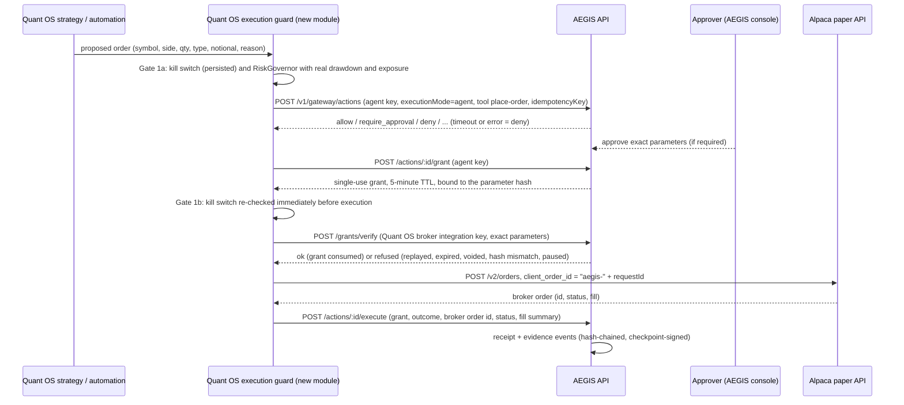

# Quant OS and AEGIS: audit, integration design and plan

**Status:** research and design only, prepared 14 October 2026. Nothing in this document has been implemented.
- No trade has been placed.
- No dependency has been installed.

The only network calls were reads of public repository and standards pages, made to verify licences and maintenance. They are listed in section 5.

**Repositories:**
- **AEGIS:** `jzaky/School`, directory `aegis/`, branch `claude/aegis-ai-governance-bgmcnk`.
- **Quant OS:** `jzaky/quantos`, public, audited read-only at commit `8c27f61` (version 0.7.1). This session has no write access to it.

**Goal:** use Quant OS as a real-world demonstration of AEGIS authorizing an AI agent's financial action, with Alpaca paper trading only.

## 1. Audit: what already exists

### 1.1 AEGIS (relevant parts)

| Capability | Where | State |
|---|---|---|
| Action Gateway, decided outside the agent, default deny, six outcomes | `packages/core/src/gateway/gateway.ts` | Tested locally |
| Agent mode: AEGIS decides; the agent fetches a grant and executes itself | `executionMode: "agent"`, `POST /v1/gateway/actions/:id/grant` | Tested locally |
| Downstream grant verification, which consumes the grant once and checks the parameter hash | `POST /v1/gateway/grants/verify` (integration key), `consumeGrant` in `gateway/grants.ts` | Tested locally |
| Execution report from the agent, written as a receipt plus evidence | `POST /v1/gateway/actions/:id/execute`, `recordAgentExecution` | Tested locally |
| Approvals bound to the parameter hash, with expiry checked at execution | `approvals/`, test `gateway.test.ts` "expired approvals cannot be used" | Tested locally |
| Trading policy template: notional limits, instruments, market hours | `packages/core/src/policy/trading.ts` | Tested locally |
| Alpaca connector: paper endpoint only, live keys refused | `gateway/connectors/alpaca.ts`, demo tool `place-order` | Simulated (fake Alpaca server); live paper check scripted, needs a paper key |
| Evidence ledger: hash chain, Ed25519 checkpoints, tamper detection | `evidence/ledger.ts`, tests `evidence-signing.test.ts`, `security-regression.test.ts` | Tested locally |
| Framework mapping: catalogs as data, custom frameworks allowed | `assurance/compliance.ts`, `seed/frameworks/` (ISO/IEC 42001 and 19 others) | Tested locally; **no EN 18286 catalog** |
| Python SDK | `packages/sdk-python` | Tested locally |

### 1.2 Quant OS (audited at `8c27f61`)

Quant OS is a FastAPI back end with a Next.js front end. Its declared Python dependencies are only `fastapi`, `uvicorn` and `pydantic`. Its parts:
- strategies, backtesting and walk-forward evaluation;
- a "smart quant" layer (regime fit, net edge, correlation, Kelly sizing);
- a deterministic `RiskGovernor` and a master kill switch;
- tenant workspaces with hashed API keys and roles;
- a broker plug-in layer: `AlpacaPaperAdapter`, locked to `https://paper-api.alpaca.markets`, plus a mock adapter;
- a tenant audit feed.

None of the 22 projects under review is used, and nothing refers to AEGIS.

**Findings.** These are design facts the integration has to handle; they are not criticisms.

| Id | Finding | Evidence | Why it matters here |
|---|---|---|---|
| Q1 | The broker order route does not call the risk governor or check the kill switch | `api_saas.py`, `POST /orders` calls `adapter.submit_order` directly | A paper order can bypass Quant OS's own risk layer |
| Q2 | Automation calls the governor with `kill_switch=False` and `drawdown=0.0` hard-coded, and its loop never checks the kill switch | `saas_engine.py` line 82; `main.py` `saas_engine_loop` (line 152) | **The kill switch does not halt broker paper orders today.** Acceptance test 5 would fail. |
| Q3 | The kill switch is in-process memory, global and not persisted | `main.py` line 48 `state['killSwitch']` | It resets to "off" on restart and is not per workspace |
| Q4 | `POST /api/risk/kill-switch` and `POST /api/engine` have no authentication dependency | `main.py` lines 218 to 221 | Anyone who can reach the API can turn the kill switch off (unless a proxy in front adds authentication; not visible in the repo) |
| Q5 | Automation uses a random `client_order_id` per attempt | `saas_engine.py` line 88 | A retry after a lost response can place the order twice |
| Q6 | Repository hygiene | Compiled `.pyc` files and `railway_backend_bundle.tar.gz` committed; flat layout imported as `app.*`; smoke scripts only, no test suite; a module named `secrets.py` | Tests and packaging are needed before acceptance tests can run in CI |
| Q7 | Strong existing controls | Paper-only adapter lock; `paper_only` checks on both order paths; idempotency key on the manual route; secret references outside connection rows | Keep these; they are independent of AEGIS |

## 2. Integration architecture (minimal)

**Principle:** two independent gates, both of which must pass.
- **Gate 1:** Quant OS's own kill switch and risk governor. It never depends on AEGIS.
- **Gate 2:** the AEGIS authorization.

AEGIS is the external decision point and the evidence record. Quant OS keeps executing against Alpaca. This uses AEGIS "agent mode", which already exists.

### 2.1 Flow

### 2.2 Components

- **Quant OS execution guard** (new, small, Python, standard library only). This is the one function through which every Alpaca order passes, from both the manual route and automation. The adapter's `submit_order` is made callable only from the guard, by requiring a verified-authorization object.
- **AEGIS configuration (no new AEGIS code for the first demo):**
  - an agent "Quant OS automation" with tool `place-order`;
  - an integration "quantos-broker" whose API key can only verify grants;
  - the trading policy template set for the demo (instruments, notional limits, market hours, approval band).
- **Credentials:**
  - Quant OS keeps the Alpaca paper key, from environment variables or its secret store as today.
  - The AEGIS agent key and integration key are separate environment variables. The integration key lives only in the guard, not in strategy code.
  - Nothing is committed.

### 2.3 Required properties and how each is met

| Property | Mechanism | Already in AEGIS? |
|---|---|---|
| AEGIS independently evaluates policy, risk limits, agent identity and approvals | Gateway pipeline: agent key, granted tool, trading policy limits, velocity, approval routing | Yes |
| Execute only after valid authorization | The guard calls Alpaca only after `/grants/verify` returns ok for the exact parameters | Verification endpoint yes; the guard is new |
| Prevent authorization bypass | One execution path (the guard); the strategy layer never holds the integration key | Quant OS change (Q1, Q2) |
| Bypass detection | Phase 2: AEGIS reconciles the Alpaca paper account read-only and flags any broker order without an AEGIS receipt | New, needs approval to give AEGIS a read-only paper key |
| Token replay rejected | One live grant per request; consumption is atomic; a second verify returns `consumed` | Yes |
| Stale approval rejected | Approval expiry checked in the execution transaction; grant TTL 5 minutes; pause or suspension voids grants | Yes |
| Gateway unavailable means no execution | The guard treats timeout, connection error, non-2xx or malformed responses as deny; no cached authorizations; no retry that skips AEGIS | Quant OS change |
| Verifiable evidence of decision and broker outcome | Decision, approval, grant consumption and the agent's execution report are chained; the broker order id is the receipt reference; Phase 2 adds AEGIS-side confirmation from the broker | Yes, plus Phase 2 |
| Modified decision record detectable | Hash chain recomputation and signed checkpoints; exports with the public key | Yes |
| Kill switch independent of AEGIS | Persisted, authenticated kill switch checked in Gate 1a and Gate 1b; it works with AEGIS disabled or unreachable | Quant OS change (Q2 to Q4) |
| Lost broker response | `client_order_id = "aegis-" + requestId`; reconcile with `GET /v2/orders:by_client_order_id`; never re-send blindly | Quant OS change (Q5) |
| Paper only | Quant OS adapter lock plus AEGIS connector refusal of non-paper keys | Yes, both |

**Design choice to confirm.** In "gateway mode", AEGIS holds the Alpaca key and places the order itself. This is stronger: Quant OS could not bypass AEGIS at all. But it departs from "Quant OS executes". Agent mode is proposed for the first demo, with gateway mode as an option.

### 2.4 Evidence record and compliance mapping

Each authorized order produces one decision record, assembled from existing AEGIS rows:
- request id and correlation id;
- agent;
- tool and parameter hash;
- policy version ids;
- decision and reasons;
- approvals (who, when, parameter hash);
- grant id, issued-at, consumed-at and expiry;
- broker outcome as reported (order id, status, filled quantity and price);
- in Phase 2, the broker outcome as reconciled by AEGIS;
- the evidence sequence range and its hashes;
- the covering checkpoint and its signature.

The mapping is **pluggable data, not code**. AEGIS already stores frameworks and controls as catalog rows, with per-organization control mappings. The plan adds a **mapping profile**: rows of (evidence type, framework, control id, rationale), loaded per framework. No framework is hard-coded.

- **ISO/IEC 42001:** the catalog exists. Records map to its existing clause and Annex A identifiers.
- **EU AI Act Article 17(1):** the regulation text is public law, so records can map to the Article 17(1) points directly, for example record keeping, risk management, post-market monitoring and accountability.
- **EN 18286:2026:** a paid standard. Public sources report that CEN/CENELEC approved it in July 2026 as the quality management standard for Article 17. No confirmation was found that it has been cited in the Official Journal, so it does not yet give a presumption of conformity. Its Annex ZA scope is reported differently by different sources: Article 17(1) and Article 11(1), or Articles 11, 17 and 72.
  - **Rule:** AEGIS stores EN 18286 clause numbers and its own descriptive wording only, entered by someone holding a licensed copy. It never reproduces the standard's text, structure or tables.
  - Until then, records map to Article 17(1) and to ISO/IEC 42001.

Sources:
- [CSA research note, prEN 18286 and ISO 42001](https://labs.cloudsecurityalliance.org/research/csa-research-note-eu-ai-act-pren-18286-iso-42001-20260428/)
- [AI Act Monitor: EN 18286 published](https://www.aiactblog.nl/en/ai-act-monitor/en-18286-ai-quality-management-standard-published)
- [ELOT draft listing](https://standardsdevelopment.elot.gr/drafts/11184)
- [Modulos summary](https://docs.modulos.ai/frameworks/eu-ai-act/harmonized-standards/en-18286)

## 3. Acceptance tests (failing-first)

To be written **before** the implementation, and to fail first for the reason stated. They are specified here and written after approval.

| # | Test | Where | Why it fails today |
|---|---|---|---|
| T1 | Gateway unavailable means no execution: with AEGIS unreachable, timing out, returning 5xx or returning malformed JSON, the guard places no Alpaca order and records `blocked: aegis_unavailable` | Quant OS `tests/test_execution_guard.py`, with a stub Alpaca server that counts calls | The guard does not exist |
| T2 | A replayed authorization token is rejected: the same grant presented twice; the second verify is refused `consumed` and no second Alpaca call is made | Quant OS test against a stub AEGIS, plus AEGIS integration test `quantos-flow.test.ts` against the real gateway | Quant OS side: the guard does not exist. AEGIS side: already passes. |
| T3 | An expired or stale approval is rejected: approval past expiry, a grant past its 5-minute TTL, and a grant voided by a gateway pause; each yields no Alpaca call | Both, as T2 | Quant OS side: the guard does not exist. AEGIS side: already passes. |
| T4 | A modified decision record is detectable: alter one field of a stored decision or evidence row with the owner role; chain verification reports the first bad sequence | AEGIS `quantos-flow.test.ts`, reusing the evidence tamper approach of `security-regression.test.ts` | Already passes for AEGIS evidence in general; the new test pins it to a trading decision record |
| T5 | The Quant OS kill switch halts execution with AEGIS fully bypassed: with AEGIS disabled in configuration, or answering "allow", an active kill switch stops the manual route and automation and places no Alpaca order; it survives a restart; it cannot be changed without an admin key | Quant OS tests | **Fails today because of Q1 to Q4** |

All tests use stub servers for Alpaca and, on the Quant OS side, for AEGIS. They need no network access and no credentials. A separate, opt-in live check against Alpaca **paper** runs only with keys typed into the shell, and only after approval.

## 4. Repository comparison

Filled in from the verified research in section 5. Classification: Adopt, Use as a reference, Defer, Reject.

Classes: **Adopt** (use now, after approval), **Reference** (study the design, take no code or dependency), **Defer** (useful later, not needed for this integration), **Reject** (licence or fit rules it out).

**For Quant OS**

| Project | What it is | Fit and overlap | Class |
|---|---|---|---|
| alpaca-py | Official Alpaca SDK | Quant OS already has a small standard-library adapter locked to the paper endpoint. The SDK would add pandas, websockets and other dependencies for no capability this integration needs. | **Reference** (for API behaviour, e.g. order lookup by client order id) |
| quantstats | Portfolio performance and tear-sheet reports | Would improve Quant OS reporting; Apache-2.0. It pulls yfinance, whose data is subject to Yahoo's terms. | **Defer** (adopt only if reporting becomes a goal; needs install approval) |
| qlib | Microsoft quant research platform | Large research framework that overlaps Quant OS backtesting; MIT. More complexity than this demo needs. | **Defer** |
| nautilus_trader | Rust/Python event-driven trading engine | Would replace Quant OS's execution core; LGPL-3.0 (the repo says "only" and PyPI says "or later", so this needs legal confirmation). | **Defer** (rebuild risk; LGPL compliance) |
| finBERT | Financial sentiment model | The code is Apache-2.0, but the published weights are CC-BY-NC-SA-4.0: non-commercial and share-alike. | **Reference** for the code; **Reject** the weights. Alternative: train your own weights on licensed data, or use a model with a commercial licence. |
| vectorbt | Vectorized backtesting | Apache-2.0 **with Commons Clause**, so it is not open source: it bars selling a product whose value derives substantially from it. | **Reject**. Alternatives: Quant OS's own backtester, qlib (MIT), quantstats (Apache-2.0) for analytics. |
| backtrader | Event-driven backtesting | GPL-3.0; last PyPI release 2023. | **Reject**. Alternatives: as for vectorbt. |
| freqtrade | Crypto trading bot | GPL-3.0, with GPL dependencies (`technical`, `freqtrade-client`); crypto-focused. | **Reject**. No replacement needed. |

**For AEGIS**

| Project | What it is | Fit and overlap | Class |
|---|---|---|---|
| langchain-ai/langgraph | Agent orchestration library | AEGIS already ships a LangGraph adapter (`aegisToolNode`). The library is MIT; the separate server runtime `langgraph-api` is Elastic-2.0. | **Adopt** as an integration target (library only); **Reject** `langgraph-api` |
| open-policy-agent/opa | Policy engine (Rego) | AEGIS has its own deterministic engine and an experimental, untested OPA adapter. Adopting OPA would create a second policy engine, against the "one policy engine" rule. | **Reference** (keep the adapter experimental) |
| cerbos/cerbos | Policy decision point | Same overlap as OPA; Apache-2.0. | **Reference** |
| openfga/openfga | Relationship-based authorization (Zanzibar) | Useful if per-resource sharing grows complex; AEGIS uses tables and a resolver today. Apache-2.0. | **Defer** |
| temporalio/temporal | Durable workflows | Approval and reconciliation workflows already run on PostgreSQL jobs. Temporal needs its own cluster. MIT. | **Defer** |
| inngest/inngest | Event and workflow server | The server is **SSPL-1.0**, converting to Apache-2.0 three years after each release, so it is source-available now. | **Reject**. Alternatives: the existing PostgreSQL job queue, or Temporal (MIT). |
| langfuse/langfuse | LLM tracing and evaluation | MIT core, but the `ee/` folders are proprietary; it needs ClickHouse. Not needed for trade authorization. | **Defer** (MIT core only, enterprise features off) |
| modelcontextprotocol/servers | Reference MCP servers | Good fixtures for testing the AEGIS MCP gateway; Apache-2.0 and MIT; the project calls them "not production-ready". | **Reference** (test fixtures) |
| sigstore/rekor | Transparency log | Could anchor AEGIS evidence checkpoints publicly, which strengthens "verify without trusting us". v1 is in maintenance mode, with v2 under way. Apache-2.0. | **Defer** (until Rekor v2) |

**Security tools** (all permissive; none would be shipped inside the product)

| Project | What it is | Fit and overlap | Class |
|---|---|---|---|
| anchore/syft | SBOM generator | Produces the CycloneDX and SPDX files AEGIS software approvals already read. Apache-2.0. The update check is on by default (`SYFT_CHECK_FOR_APP_UPDATE=false`). | **Adopt** in CI only, pinned version, update check off (needs install approval) |
| aquasecurity/trivy | Vulnerability and misconfiguration scanner | AEGIS already parses Trivy reports. Apache-2.0. **Critical supply-chain compromise in March 2026** (GHSA-69fq-xp46-6x23: malicious v0.69.4 to v0.69.6 artifacts, force-pushed action tags). Telemetry on by default. | **Adopt** in CI only, pinned by digest, cosign-verified, `--disable-telemetry --skip-version-check` (needs install approval) |
| promptfoo/promptfoo | LLM eval and red-team CLI | Could red-team the AEGIS AI Gateway and agent paths in CI, complementing the built-in lab. MIT. Telemetry, update checks and remote test generation are on by default. Now owned by OpenAI. | **Defer** (if adopted: CI only, with `PROMPTFOO_DISABLE_TELEMETRY=1`, `PROMPTFOO_DISABLE_UPDATE=1`, `PROMPTFOO_DISABLE_REMOTE_GENERATION=1`) |
| NVIDIA/garak | LLM vulnerability scanner | Overlaps the lab and promptfoo; heavy Python dependencies (torch, transformers); probes download datasets with their own licences. Apache-2.0. | **Defer** |
| PyRIT (now microsoft/PyRIT; Azure/PyRIT is archived) | Red-team framework | Useful patterns for multi-turn attack orchestration. MIT. | **Reference** (use the microsoft/PyRIT repository) |

## 5. Licensing assessment

Assumption: AEGIS and Quant OS are deployed at client sites commercially, as closed source. Checked 14 October 2026 from each repository's LICENSE and manifest files and from PyPI, Hugging Face and crates.io metadata.

GitHub's API and HTML pages were blocked from the build environment, so these were **not verified**:
- archived flags;
- last-commit dates;
- GitHub advisories;
- full transitive dependency trees, including JavaScript and Python lockfiles. Go `go.mod` files were scanned by module name only.

**Copyleft and source-available findings**

| Item | Licence | Effect | Decision and permissive alternative |
|---|---|---|---|
| backtrader | GPL-3.0 | Shipping it forces source disclosure | Reject. Use Quant OS's own backtester or qlib (MIT). |
| freqtrade, `technical`, `freqtrade-client` | GPL-3.0 | Same | Reject |
| vectorbt (and `vectorbt-rust`) | Apache-2.0 with Commons Clause | Not open source; selling a product built on it is barred | Reject. Use quantstats (Apache-2.0) or qlib (MIT). |
| finBERT published weights | CC-BY-NC-SA-4.0 | Non-commercial use only, share-alike | Reject the weights. Train your own, or use a commercially licensed model. |
| inngest server | SSPL-1.0 (Apache-2.0 after 3 years) | Source-available; SSPL section 13 can reach the whole service stack | Reject. Use the PostgreSQL job queue or Temporal (MIT). |
| langgraph-api (LangGraph server runtime) | Elastic-2.0 | Source-available; no managed-service use; licence-key restrictions | Reject. Use the MIT `langgraph` library only. |
| langfuse `ee/` folders | Proprietary enterprise licence | Needs a paid licence | Run the MIT core only, with no enterprise features enabled |
| nautilus_trader | LGPL-3.0 (only vs or-later conflict) | Usable unmodified as a replaceable library; changes to it must be released | Defer; legal confirmation needed. Avoid its `ib` extra (proprietary IB API licence). |
| python-telegram-bot (via vectorbt `full`, freqtrade) | LGPL-3.0-only | Weak copyleft | Not pulled in, because both parents are rejected |
| hashicorp and other Go modules (OPA, Cerbos, OpenFGA, Temporal, Rekor) | MPL-2.0 | File-level copyleft: fine unmodified, with notices; disclose only modified MPL files | Acceptable if these projects are ever adopted |
| `sharp-libvips` (already in AEGIS, via Next.js) | LGPL-3.0-or-later | Prebuilt binaries | Already flagged in `docs/THIRD_PARTY.md`. Removable by disabling Next.js image optimization. |

**Permissive (no disclosure obligation):**
- alpaca-py, quantstats and qlib;
- finBERT code;
- OPA, Cerbos, OpenFGA, Temporal, LangGraph library, MCP servers and Rekor.

Each still needs its NOTICE or attribution files kept.

**Third-party service terms (separate from code licences):** Alpaca's service terms, and Yahoo's terms for yfinance data used by quantstats.

**Security tools:** garak and syft (Apache-2.0); promptfoo and PyRIT (MIT); trivy (Apache-2.0, with Apache-2.0 and MIT databases). All are permissive. syft and trivy pull MPL-2.0 Go modules, which are fine unmodified. Upstream vulnerability-feed terms and garak probe-dataset licences were not reviewed.

No source code from any project reviewed here has been copied into AEGIS or Quant OS.

## 6. Implementation plan (after approval)

| Phase | Work | Repository | Effort | Gate |
|---|---|---|---|---|
| 0 | Approve this design. Choose agent mode or gateway mode. | | | Your approval |
| 1 | Quant OS safety fixes independent of AEGIS (Q1 to Q5): persisted, authenticated, per-workspace kill switch; governor on every broker path with real drawdown and exposure; deterministic `client_order_id`; a test harness. Tests T5 and T1 written first. | quantos (needs write access) | 1 to 2 days | Tests T5 red, then green |
| 2 | Execution guard in Quant OS (standard library HTTP client to AEGIS; fail closed; verify, then execute, then report; reconcile on lost response). Tests T1 to T3 written first. | quantos | 2 days | T1 to T3 red, then green |
| 3 | AEGIS configuration and test: agent, integration, trading policy and tool for Quant OS; `quantos-flow.test.ts` covering T2 to T4 against the real gateway with a fake Alpaca server | AEGIS | 1 day | All tests green in CI |
| 4 | Mapping profile: evidence type to control rows for ISO/IEC 42001 and AI Act Article 17(1); EN 18286 slots left for a licensed holder | AEGIS | 1 to 2 days | Mapping report renders from data |
| 5 | Live paper demo: Quant OS proposes, AEGIS decides, a person approves, Alpaca paper executes, AEGIS records. Run only with paper keys typed into the shell. | both | half a day | Your approval to place paper orders |
| 6 (optional) | AEGIS-side broker reconciliation with a read-only paper key; flag orders without an AEGIS receipt | AEGIS | 1 to 2 days | Your approval for AEGIS to hold a paper key |

**What is not planned:** rebuilding either product, adding any of the reviewed libraries as runtime dependencies, live trading, and any network call or installation without approval.
